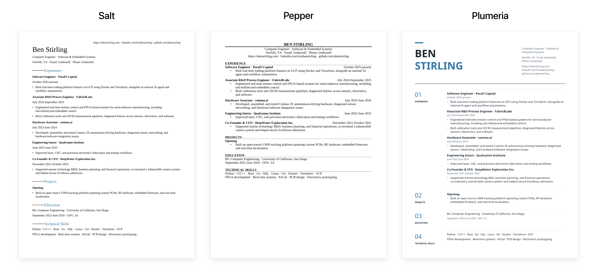

# The Jobs Application

Beautiful & simple resume generation.

Turn your Markdown into a polished resume. Pick a design, make it yours, and export a one-page PDF—all inside Obsidian.

## Install

1. Put the release's `resume-pdf` folder in your vault's `.obsidian/plugins/` folder.
2. Restart Obsidian.
3. Enable **The Jobs Application** in **Settings → Community plugins**.

## Use

Open a resume note and click **The Jobs Application** in its header.

Edit your Markdown beside a live preview. Choose **Salt**, **Pepper**, or **Plumeria**. All three use the same Markdown; switching templates changes the layout.

Click **New resume** for an example, or **Save PDF** to export.

- **Error:** more than one page. Shorten the resume to export.
- **Warning:** below the minimum page fill, adjustable in settings.
- **Ready:** content fills the page.

Choose an accent color for Salt or Plumeria. Your choice is saved.

## PDF names

`Name_Company_yyyy-mm-dd.pdf`

Name comes from your resume heading. Company is optional. The date is automatic.

## Privacy

Works offline. No account, AI, or upload required. Files stay in your vault and follow its usual sync settings.

The example uses Ben Stirling's background, with email and phone redacted.

## Development

```sh
npm ci
npm run check
npm test
npm run build
```

Builds go to `release/resume-pdf/`.

The `engine/` directory is also the shared `@tja/resume-core` package used by the website. Its public exports cover Markdown parsing, layouts, templates, fonts, example Markdown, and PDF creation. The root export is safe for the server; the PDF writer has a separate `/pdf` entry. Obsidian vault access and browser downloads stay in their respective apps. Consumers pin a Git commit, so an engine upgrade is explicit and reproducible.

## License

MIT. Bundled fonts retain their licenses in `public/fonts/`.
